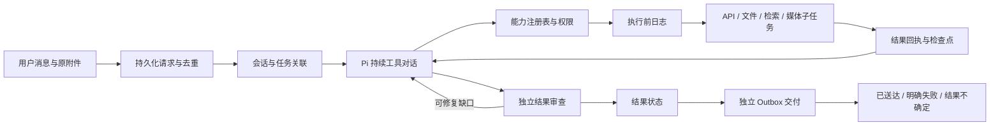

# Harness 系统改造与验收

范围：修复 [原系统审查](system-architecture-review.md) 中的输入、任务连续性、规划、能力、调度、恢复、权限和交付问题。对照设计见 [OpenClaw / Hermes 研究](openclaw-hermes-design-review.md)。点评筛选只是一个测试样本。

当前状态：本次审查范围内的系统改造、验收与上线已完成。2026-09-27 01:24（Asia/Shanghai）恢复生产服务，启动和数据库迁移复核通过。

## 现在的完整执行路径

保留 Pi agent-core 0.87.1、本地 Qwen、图片/视频工作流和常驻语音组件。Pi 负责推理和工具循环，Python 负责身份、权限、持久化、调度、验证与交付。没有叠加两套抢任务的运行时，也没有修改 Pi 上游源码。

## 改造对应关系

| 原问题 | 当前实现 | 验证方式 |
|---|---|---|
| 上传图片/文档直接走视频 | 保存原附件，再让代理按要求处理；显式 `/video` 附件命令才走首帧视频 | 路由、分页、DOCX/XLSX、真实 Vision OCR 和 PDFKit |
| 每条消息等于新任务 | 不可变用户请求、任务关联、执行尝试与会话检查点分开；语义关联追问，明确新话题独立 | 真实连续文件修改与话题切换，身份/重置隔离 |
| 执行中无法接收纠正 | 补充先持久化，在模型/工具边界注入；旧计划中未启动的动作可以阻止 | 实际 Pi 两工具批次中途纠正；真实模型生命周期评测 |
| 强制且不可修订的计划 | 普通问答无规划前置；复杂任务可修订步骤与验收条件，原请求始终保留 | 计划版本与原条件独立；实际普通问答无计划调用 |
| 工具名出现就算完成 | 先独立提取所需产物，再审查候选；schema 约束输出；需要实际数据或动作却无相应证据时，宿主禁止 completed；答复中的算术/比较声明另用 Decimal 验算 | 正常结果、缺字段、错误结论、缺凭据、审查失败 |
| 固定工具定义多份维护 | Python 能力注册表生成 Node schema，同时执行权限、可用性、参数与重放策略检查 | 注册表、权限撤销、无效参数、适配器测试 |
| API 与技能无通用接入 | 公开 JSON API、具名参数化 provider、宿主凭据注入、JSON pointer/分页；技能按需发现和读取 | 真实地理编码/天气 API；配置错误、参数、凭据与路径边界 |
| 全局锁把外部等待和发送锁住 | 最多四个会话推进，同会话有序；仅模型请求持有推理锁；交付独立 | 调度故障测试、真实模型与外部等待混合测试 |
| 重启将任务变成失败、可能重复动作 | 消息检查点、执行前日志、成功回执复用；未决批准可恢复；不确定写入不自动重放 | 实际 Pi + SQLite + 文件操作的故障注入，批准恢复 |
| 批准仅存在内存、每文件都询问 | 持久化单次批准，或一次请求内明确目录的文件写入授权；身份、会话、不可变请求与过期时间绑定 | 拒绝、取消、重启、路径范围和任务关联不能转移授权 |
| 执行结束/完成/送达混淆 | jobs.status 记录执行；outcome 记录目标状态；delivery_state 与消息回执记录交付 | 部分结果、缺输入、排队子任务、回执丢失、明确拒绝 |
| 回复成功但历史上下文丢失 | 保留完整工具对话；模型视图可以压缩，task_evidence 可分页查询原记录 | 工具对完整性、归属隔离、失败旧调用不在新请求里重做 |

## 完成与恢复的含义

- `completed`：当前要求已通过结果核验；不单凭工具成功或有正文判断。
- `partial`：已有部分结果，但仍有条件未确认。
- `pending`：实际子任务已提交，产物尚未交付。子任务完成且有交付回执后更新父任务。
- `needs_input`：完成原目标仍缺少只有用户能提供的信息；准确解释缺口不等于完成原目标。
- `blocked`：执行被实际阻碍中断，保留原请求和执行证据。
- `cancelled`：用户取消；已经发生的动作不会被假装回滚。

交付状态另行保存。Telegram 明确拒绝可按重试策略处理；网络中断、进程死亡或回执丢失无法证明消息没发出，因此记为不确定并停止自动重复发送。用户明确要求再次发送时采用新的交付请求。消息回执证明 Telegram 接受，不证明用户已读。

动作发生后、回执写入前中断时，先核对可验证的事实：文件内容是否与本次写入完全一致、媒体子任务是否实际存在、发送是否已有逐项回执。核对成功后补记执行结果，不重复动作；任意 shell 命令等无法可靠核对的操作保持不确定。跨后续消息关联到同一任务，也不能绕过这种保护。

异步媒体提交的准确进度说明可以交付，任务保持 `pending`；产物尚未生成不会触发无意义的状态轮询或被误报为执行失败。后台生成、发送及父任务最终完成仍分别依赖真实记录。

## 配置与边界

- `config/providers.json`：只读 GET provider，参数 schema、默认参数、可选 `PROVIDER_*` 专用凭据；带凭据的 provider 默认仅管理员可见，只有本机配置明确指定 `access: user` 才可共享给已授权用户。已配置 Open-Meteo 地理编码和天气。官方接口说明：[地理编码](https://open-meteo.com/en/docs/geocoding-api)、[天气](https://open-meteo.com/en/docs)。不能把公开天气接口等同于已经接入点评或公司内网。
- `assistant-skills/<name>/SKILL.md`：相关任务才读取。技能、网页和附件都是资料，不能授予权限。
- `generate_audio`：独立文本转语音，最多 600 字；不是音乐合成，也不把音频请求替换成视频。
- 原始 shell 命令仍需单次确认。目录写入授权不等于 shell 沙箱；模型修改计划或关联任务不能转移权限到另一请求。
- 图片 OCR 不等于完整视觉理解；截断的文档或数据必须继续分页或明确覆盖范围。
- 执行中的文字纠正和带说明的新附件可在工具边界生效；语音消息仍先排队转录，再处理其含义。已经发生的动作不能靠后来的纠正撤销。
- 保留 32k 模型上下文和有界执行预算；持久化不代表模型能同时处理无限历史。语义关联和审查仍可能出错，因此保留失败样本和真实回放，不声称任意任务百分之百成功。

结构化审查使用 llama.cpp 的 schema-constrained JSON，接口依据：[官方 server 文档](https://github.com/ggml-org/llama.cpp/blob/master/tools/server/README.md)。

## 验证与上线记录

测试分为三类，不混称真实端到端：

1. 组件与故障注入：实际 SQLite、Pi、文件系统及原生附件解析；模型响应或 Telegram 接口在部分测试中用可控模拟。
2. `scripts/evaluate_system.py`：真实本地模型、实际文件、真实 API；覆盖问答、多步骤写入、追问、话题切换、附件条件筛选、缺凭据和未用于规则设计的库存/恶意附件指令样本。
3. `scripts/evaluate_lifecycle.py`：真实模型的中途纠正、媒体子任务提交及混合负载。混合负载在真实 API 返回后人为保持等待，以确认另一会话能完成。媒体验证提交与状态，不重复渲染未修改的模型后端。

探索测试中的失败记录保留：任务关联漏记、审查 JSON 无效、把“说明缺口”误标为原任务完成，均在复测前修正。最后一项在单纯加强提示后仍复现，因此新增与候选答复隔离的产物契约和宿主证据必要条件；不是把“调用工具”重新作为充分完成条件。另将候选算术/比较声明交给 Decimal 核验，已用曾错误通过的真实答案复测，正确阻止 `4.0 > 4` 被宣称为真。声明提取仍依赖模型，不能宣称覆盖任意自然语言表达。macOS 子进程退出竞态也已修复，避免清理失败覆盖正常结果。筛选评测也修正了断言未识别 `✗` 符号的测评器问题；没有把错误计算改成通过标准。

目前已确认的验收证据：

- 组件与故障注入：`143 passed`，4.61 秒；六条警告均为 Telegram 库未来 RetryAfter 类型变化的弃用提示。
- 真实模型八场景：[复核结果](../runtime/system-upgrade/acceptance-1790441981/results-validated.json)，8/8。保留[原始结果](../runtime/system-upgrade/acceptance-1790441981/results.json)：其中筛选答复正确排除了临界值，但旧评测器未识别表格“否”而误报。修正逐行判断后只重判原答案，没有改写答案；新增测试防止相邻行影响判定。
- 已知错误答案回归：[真实审查结果](../runtime/system-upgrade/review-regression-1790441935/result.json)，错误的 `4.0 > 4 = true` 被独立计算拒绝。
- 最终生命周期首轮发现并修复了异步媒体交接的状态问题：[失败记录](../runtime/system-upgrade/lifecycle-1790442717/results.json)。有效的排队通知不再因尚无最终产物而被当成失败；不存在实际子任务的“正在处理”仍被拒绝。
- 随后复测发现相同问题还有执行顺序分支：模型把准确的排队说明标成 completed 时，原逻辑先验收最终产物，再降为 pending，仍会误报。现已先依据实际子任务状态归一化，再判断进度说明；增加两种模型判定的对照测试。该次复测在保留前两项通过结果后主动中断，未计为整轮通过：[记录](../runtime/system-upgrade/lifecycle-1790443100/results.json)。

八场景评测之后补充的凭据权限默认值、附件纠正、动作核对恢复与异步媒体状态修复，由新增组件/故障测试和最终生命周期复测覆盖；不将早期八场景描述为全部运行于最终源码。各真实运行均保存源码哈希及运行期间未变更的记录。测试数据库独立于生产，不向 Telegram 发送测试消息。

最终生命周期复测：[结果](../runtime/system-upgrade/lifecycle-1790443301/results.json)，3/3 通过，运行期间源码未变化，上线前再次核对哈希一致。真实 API 等待期间，另一会话在 16.54 秒内完成；执行中追加附件与取消文件写入生效；媒体只创建一个实际子任务并保持 pending。媒体验证范围是交接和状态，未渲染、未向 Telegram 发送测试图片。

生产上线：[部署复核](../runtime/system-upgrade/deployment.json)。LaunchAgent `local.qwen.telegram` 已 running，01:24:22 日志确认 `Telegram Bot ready` 和 `Application started`；十个任务/检查点/审批/交付相关表已存在，数据库 `integrity_check=ok`，启动日志没有异常。既有用户数据保留，测试任务未导入生产。Telegram 实际发送路径由可控故障测试覆盖，本轮没有发送测试消息，因此不把启动健康检查称为真实收件端验收。

## 运维与回滚

部署前基线：`runtime/system-upgrade/baseline-1790437784.tar.gz`；数据库快照为同目录 `baseline.sqlite3`。新增表和列采用兼容迁移。回滚代码前先停止服务并保存当前数据库；不能直接覆盖上线后的数据库而丢弃新请求。

上线前另留存生产数据库、源码及哈希清单：`runtime/system-upgrade/predeploy-1790443125/`。生产数据库完整性检查为 `ok`，当时没有排队或执行中的任务。

常规检查：`.venv/bin/python -m pytest -q`、`vendor/node pi/runner-v2.mjs --check`。运行真实模型评测前先停止机器人服务，评测结束释放引擎，再恢复服务；避免两个进程争用本地 GPU。
